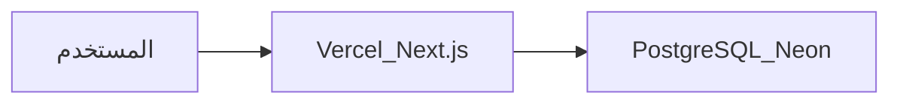

# دليل نشر كلشي طيب على الإنترنت

هذا الدليل ينشر **الواجهة + الخادم** معاً (تطبيق Next.js) مع **PostgreSQL** منفصل.



| الجزء | أين يُنشر |
|--------|-----------|
| Frontend + Server Actions (`apps/web`) | [Vercel](https://vercel.com) |
| قاعدة البيانات (`packages/database`) | [Neon](https://neon.tech) أو Supabase أو أي Postgres مداره |

---

## المتطلبات قبل البدء

1. حساب GitHub (المستودع مرفوع).
2. حساب [Vercel](https://vercel.com) (تسجيل عبر GitHub).
3. حساب [Neon](https://neon.tech) (مجاني للبداية) — أو أي مزوّد PostgreSQL.

---

## 1) إنشاء قاعدة البيانات (Neon)

1. من لوحة Neon: **Create Project**.
2. انسخ **Connection string** (عادة يبدأ بـ `postgresql://...`).
3. احتفظ به سراً — سيُضاف لاحقاً في Vercel باسم `DATABASE_URL`.

اختياري محلياً للتحقق:

```bash
# في ملف .env بالجذر
DATABASE_URL="postgresql://...من_Neon..."
ADMIN_SESSION_SECRET="سلسلة_عشوائية_طويلة_جدا"

npm install
npm run db:migrate:deploy
npm run db:seed
```

---

## 2) ربط المشروع بـ Vercel

1. افتح [vercel.com/new](https://vercel.com/new).
2. Import مستودع **كلشي طيب** من GitHub.
3. إعدادات المشروع:

| الحقل | القيمة |
|--------|--------|
| Framework Preset | Next.js |
| Root Directory | `apps/web` |
| Build Command | `cd ../.. && npm run db:generate && npm run build -w @koulshy/web` |
| Install Command | `npm install` (من جذر الـ monorepo) |
| Output | افتراضي Next |

> إذا واجهة Vercel لا تشغّل التثبيت من الجذر تلقائياً: فعّل **Include source files outside Root Directory** / اضبط Root على المستودع كله واترك:

| الحقل | القيمة البديلة (الجذر) |
|--------|-------------------------|
| Root Directory | `.` (جذر المستودع) |
| Build Command | `npm run build` |
| Install Command | `npm install` |

الطريقة البديلة (Root = `.`) أبسط مع هذا الـ monorepo.

---

## 3) متغيرات البيئة في Vercel

Project → **Settings → Environment Variables** — أضف للبيئات Production (و Preview إن رغبت):

| الاسم | مثال / ملاحظة |
|--------|----------------|
| `DATABASE_URL` | رابط Neon (يفضّل pooled للـ serverless إن وفّره Neon) |
| `ADMIN_SESSION_SECRET` | قيمة عشوائية قوية (مثلاً 32+ حرف) |
| `ADMIN_SEED_IDENTIFIER` | اختياري — لإنشاء أدمن عند الـ seed فقط |
| `ADMIN_SEED_PASSWORD` | اختياري — لا تتركه بعد أول نشر إن استخدمت seed |
| `NOTIFICATION_PROVIDER` | `mock` (الإرسال الآلي؛ deeplink منفصل) |
| `NOTIFICATION_DEFAULT_CHANNEL` | `WHATSAPP` أو `SMS` (تسمية القناة) |
| `KITCHEN_WHATSAPP_E164` | رقم مطبخ واتساب بدون `+` (مثال `9647XXXXXXXXX`) — لتثبيت الطلب عبر wa.me |
| `BLOB_READ_WRITE_TOKEN` | اختياري — رفع صور الأدمن عبر Vercel Blob في الإنتاج |

ثم **Redeploy**.

---

## 4) تطبيق ترحيلات قاعدة البيانات على الإنتاج

بعد توفر `DATABASE_URL` للإنتاج، من جهازك (مرة واحدة أو عبر CI):

```bash
# تأكد أن .env يشير لقاعدة الإنتاج أو مرّر المتغير
$env:DATABASE_URL="postgresql://..."   # PowerShell
npm run db:migrate:deploy
```

أو من Neon SQL Editor فقط إن كنت تدير SQL يدوياً — المفضّل `migrate deploy`.

إنشاء أدمن أول مرة (إن لم تستخدم seed):

- عبّئ `ADMIN_SEED_*` وشغّل `npm run db:seed` مرة واحدة ضد قاعدة الإنتاج، ثم احذف كلمات المرور من Vercel إن وُجدت.

---

## 5) التحقق بعد النشر

1. افتح رابط Vercel للموقع (الصفحة الرئيسية).
2. جرّب القائمة وإضافة للسلة (وضع الضيف).
3. افتح `/admin` وسجّل دخول الأدمن.
4. إن ظهرت أخطاء DB: راجع `DATABASE_URL` و`migrate deploy`.

---

## 6) نطاق مخصص (اختياري)

Vercel → Project → **Settings → Domains** → أضف نطاقك واتبع تعليمات DNS.

---

## هيكل الأوامر المفيدة

```bash
npm run dev                 # تطوير محلي
npm run build               # بناء الفرونت + generate Prisma
npm run db:migrate:deploy   # ترحيلات الإنتاج (لا تنشئ migration جديدة)
npm run db:studio           # استكشاف البيانات محلياً
```

---

## ملاحظات أمنية

- لا ترفع ملف `.env` إلى GitHub (موجود في `.gitignore`).
- لا تشارك `ADMIN_SESSION_SECRET` أو كلمات مرور الأدمن.
- الإشعارات حالياً `mock` — لا تُرسل واتساب/SMS حقيقي حتى تربط مزوّداً لاحقاً.

---

## بدائل سريعة

| الهدف | خيار |
|--------|------|
| Postgres بدل Neon | Supabase / Railway / Render Postgres — نفس `DATABASE_URL` |
| استضافة غير Vercel | أي Node 20+ يستضيف Next: `npm run build && npm run start` مع نفس المتغيرات |
| فصل API لاحقاً | اليوم Server Actions داخل `apps/web`؛ استخراج REST يكون مرحلة لاحقة |
